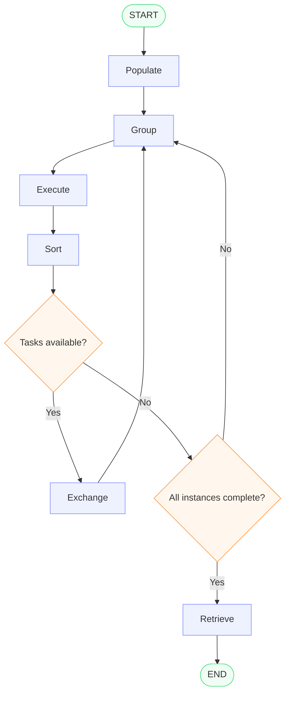
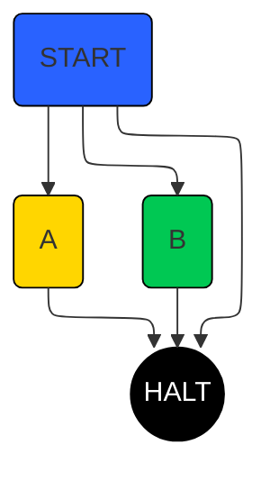

Loom is a proof-of-concept virtual machine for SPMD (single program-multiple data) execution, embedded in C++.
The purpose of this project is to answer question: can we counter control-flow divergence and increase throughput by sorting and regrouping threads?

    Control-flow divergence occurs when parallel threads executing the same program take different execution paths due to data-dependent branches.
    In SIMD/SIMT architectures, threads following different paths must typically execute them in separate groups or under predication, leaving some processing lanes idle and reducing effective hardware utilization.

Example of Cornell Box rendering process with different VM backends:

| predicated  | hybrid (size=1024)  | hybrid (size=4000)  |
|:-----------:|:----------------:|:----------------:|
| <video src="groundflyer.github.io/loom/assets/video/predicated.webm" muted autoplay controls width="100%"></video>  | <video src="groundflyer.github.io/loom/assets/video/hybrid_s1024.webm" muted autoplay controls width="100%"></video> | <video src="groundflyer.github.io/loom/assets/video/hybrid_s4000.webm" muted autoplay controls width="100%"></video> |

In order to experiment freely I had to simplify and restrict conventional SPMD programming model significantly.
The resulting programming model heavily adapts unstructured control flow.
I tried to formalize the model and have drafted an [article](groundflyer.github.io/loom/assets/pdfs/draft.pdf).

## TL;DR

Having a thread pool of persistent threads (SPMD kernel instances),
let's sort the threads by program counter and regroup them into more coherent groups.

Let's consider a kernel with unstructured control flow.

Thread pool evolution during execution is illustrated with this graph 

## Implementation

The VM targets x86 vector extension from SSE to AVX-512 and implements two main SIMD backends:

* compact - predicated warp execution with dynamic reconvergence
* hybrid - compact SIMD backend integrated within thread pool sorting and regrouping

In path tracing benchmarks the hybrid backend is consistently faster than the compact one.

There are other backends developed for validation and testing, but most of interest could be BSE (Basic Scalar Evaluator).
Its performance is roughly the same as plain C++.

# Build

## Prerequisites

To build all benchmarks and demo you need:

* GNU/Linux distribution
* 32Gb RAM (explanation further)

## Build with nix

The easiest way to build is to use [nix package manager](nix.org).

Just `cd` to source directory and run `nix build`.

Apart from `default` build target there are `complete` and `minimal` ones.

## Generic linux distro

Even if you don't run [NixOS](nixos.org) or don't have nix installed
you still can build everything with CMake.

### Dependencies

* CMake
* LLVM clang version 19 or newer
* LLVM libc++ version 19 or newer
* libfmt version 9 or newer
* glfw3
* range-v3
* fast_float
* hwloc

The last four can be downloaded by cmake.

`./build.sh -b -demo -l` to build benchmarks and demo, add `-f` if you're too lazy to install dependencies
with your distro package manager.
See `./build.sh -h` for more options.

If you're going to build manually with CMake ensure the stack size is unlocked: `ulimit -s unlimited`.
Otherwise, the build of path-tracing benchmarks and demo will fail with stack overflow error.

# Run

To run all benchmarks you need CPU with at least AVX support, but the best results give AVX-512 processors (not only because of SIMD width).

Run all benchmarks:
`src/scripts/benchmark all <dir_with_binaries> <dir_with_benchmark_results>`.

For example, nix users have `<dir_with_binaries>` to be `result/bin/`.

Except `all`, the other options for benchmarks are `light` and `render`.

The interactive demo executable is called loom_pt_demo. Invoke with `-h` to see available options.

# FAQ

**Q:** Why 32Gb RAM just to build one file?
**A:** Kernel preprocessing, basic-block construction and consistency checks is done at compile time via template metaprogramming.
The template instantiation depth for bigger kernels is so deep, the stack limits need to be unlocked.
Path-tracing kernel consists of ~1.5K instructions and clang consumes almost 30Gb during its compilation.

# License

Loom: GNU GPL v3

stb_easy_font.h: public domain

static_math: The MIT License (MIT)
