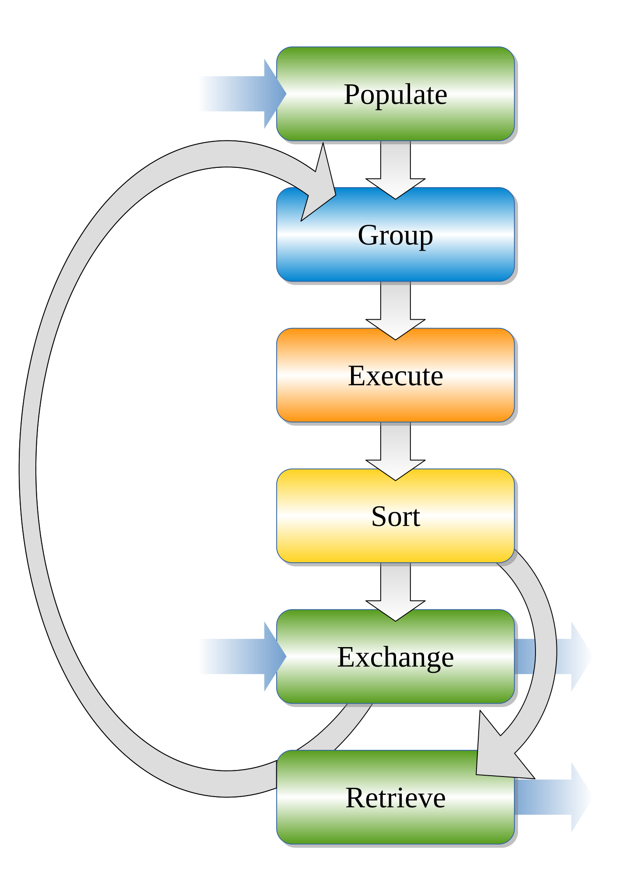
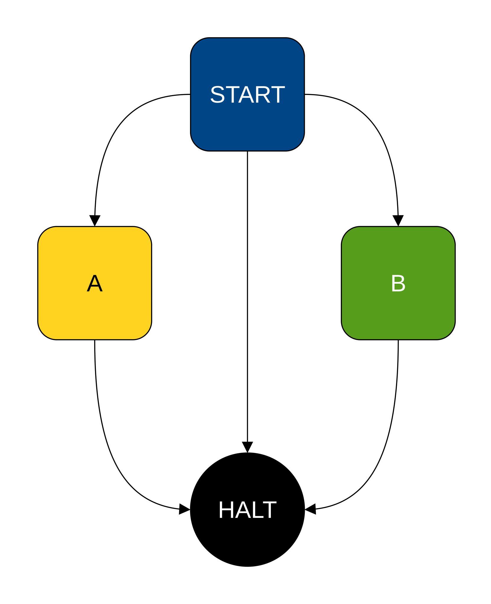
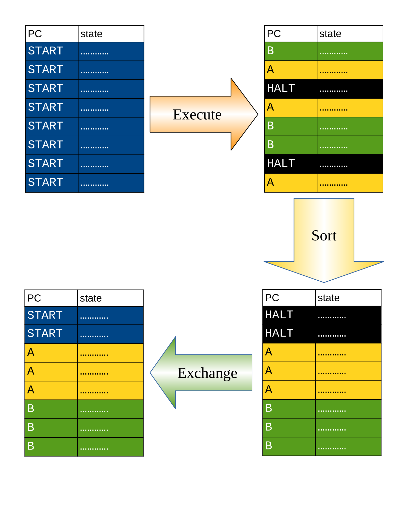

# Architecture Overview

## Introduction

The project implements an abstract execution machine for data-parallel SPMD programs.

Unlike conventional SIMD and SIMT execution models, where groups of program instances typically advance through execution in a coordinated manner, this machine uses dynamic scheduling and regrouping based on the current execution state of individual instances.

The primary objective is to reduce the impact of control-flow divergence while maintaining a relatively simple and portable execution model.

## Execution Model

### SPMD Programming

A program is defined once and executed by multiple independent instances. Each instance maintains its own execution state and progresses through the same program according to its input data and control flow.

Instances do not require a globally synchronized execution order.

### Abstract Machine

The abstract machine operates on a collection of execution instances, each maintaining:

- A set of virtual registers representing persistent program state.
- A program counter identifying the next basic block to execute.
- Input and output values defining the instance's interaction with the surrounding system.

The machine executes instructions associated with the current basic block and updates the execution state of each instance.

### Basic Blocks and Control Flow

Programs are represented as control-flow graphs composed of basic blocks.

Each basic block contains a sequence of instructions and terminates with a control-flow operation that determines the next block pointer.

The block pointer is the primary scheduling key used to identify instances that can execute the same basic block together.

## Scheduling and Regrouping

### Dynamic Grouping

At scheduling boundaries, execution instances are grouped according to their block pointers.

Instances sharing the same block pointer can execute the corresponding basic block together, improving execution coherence.

### Unordered Execution

The execution system does not maintain the original ordering of independent instances.

This removes the need to reconstruct a global execution order after regrouping and allows instances to progress according to their individual execution requirements.

### Streaming Execution

The machine processes instances incrementally. Completed or otherwise eligible instances can exchange execution slots with newly available work, allowing the system to maintain throughput without requiring all instances to complete together.

The flowchart of the algorithm:

{width=300}

Evolution of the virtual machine state during execution of an exemplary kernel:

| Kernel' CFG  | VM States |
|:-:|:-:|
| {width=400}  | {width=400}  |

## Hardware Mapping

The abstract machine is designed to support multiple implementation strategies.

### CPU SIMD

On CPUs, groups of instances can be mapped to fixed-width SIMD execution units. Predication and vector instruction selection can be used to handle differences between individual instance states.

### GPU SIMT

On GPUs, the execution model can be mapped to hardware execution groups and scheduling units. Dynamic regrouping provides an alternative to relying exclusively on hardware-managed divergence and reconvergence.

### Heterogeneous Execution

The abstract execution model is not inherently tied to a specific hardware architecture. Different backends can implement the same programming semantics while exploiting their respective hardware capabilities.

## Implementation Architecture

The implementation is organized around several major components:

- **Program representation:** Defines the instruction set, basic blocks and control-flow relationships.
- **Execution memory:** Stores persistent execution state for active instances.
- **Scheduler:** Selects and groups instances for execution.
- **Execution backend:** Implements instruction execution on the target hardware.
- **Input/output handling:** Provides interfaces for supplying work and collecting results.
- **Inspection and debugging:** Exposes execution state and scheduling behavior for development and analysis.

## Further Reading

- [Draft Article](../assets/pdf/draft.pdf)
<!-- - [Programming Model](programming-model.md) -->
<!-- - [Instruction Set](instruction-set.md) -->
<!-- - [Scheduling](scheduling.md) -->
<!-- - [Implementation](implementation.md) -->
<!-- - [API Reference](../api-reference.md) -->
